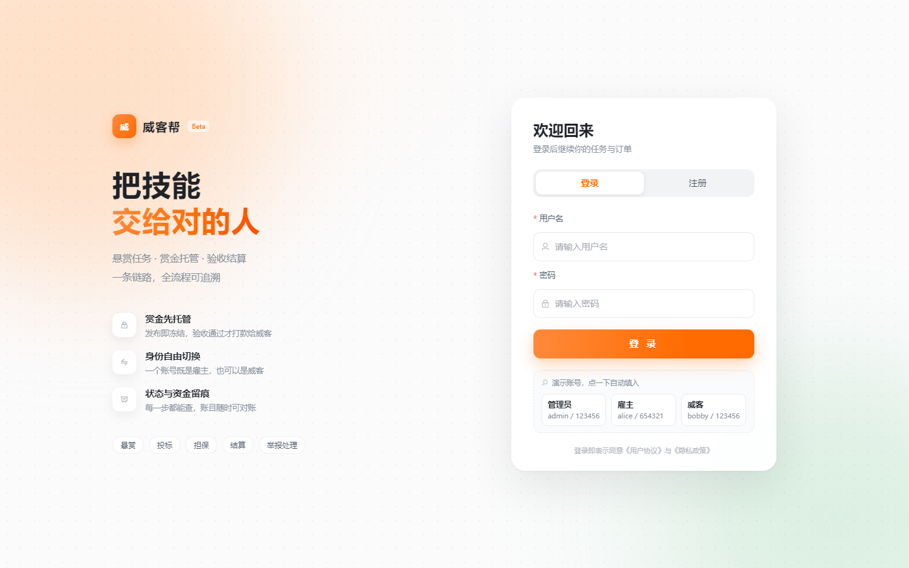
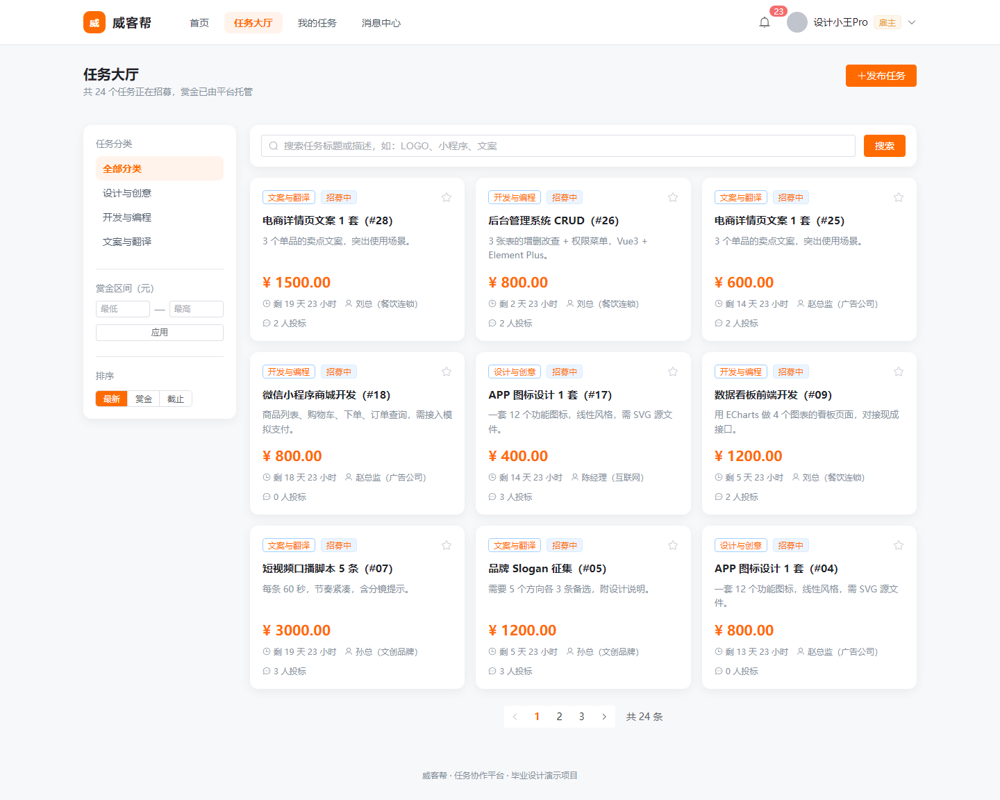
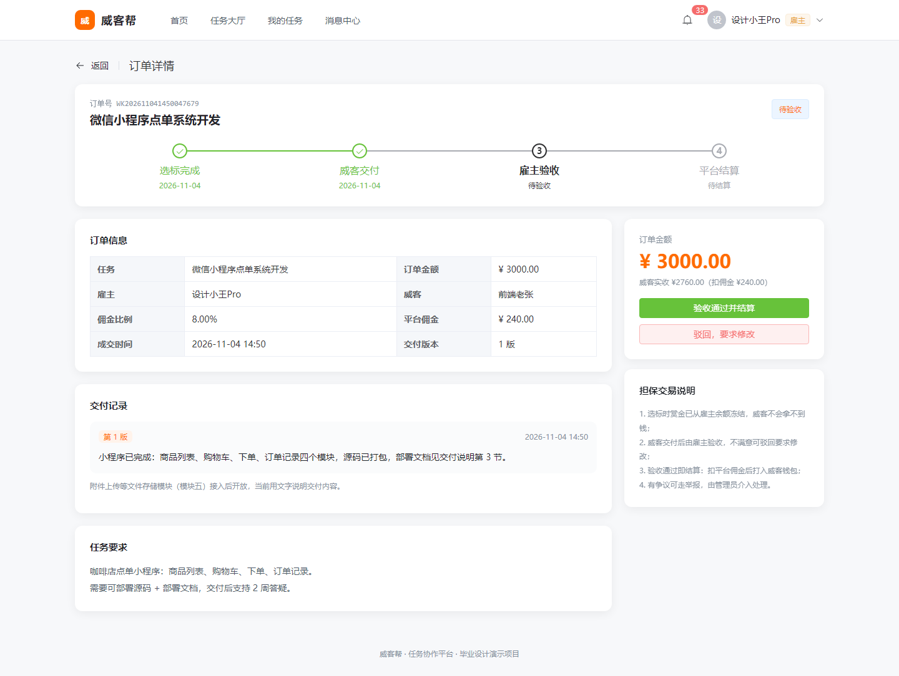
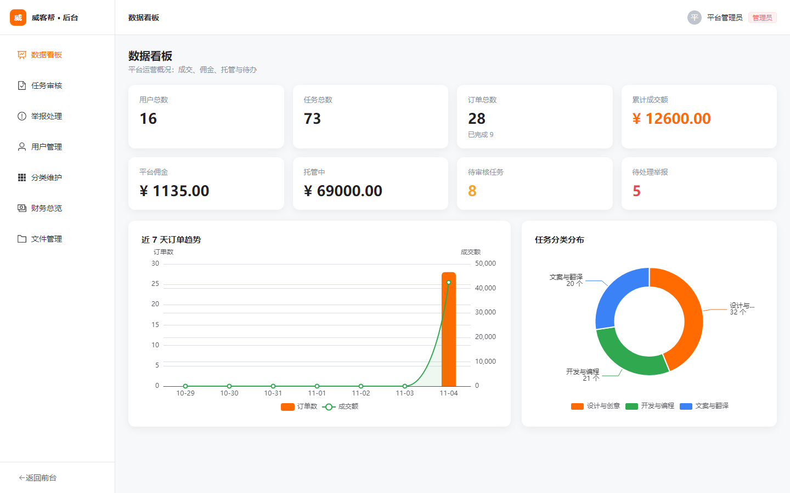

# 威客任务平台设计与实现

一个面向技能交易的双边撮合平台：**雇主发布任务并托管赏金，威客投标交付，平台审核与结算**。
前后端分离，覆盖「发布 → 审核 → 投标 → 选标 → 交付 → 验收 → 结算 → 提现」的完整业务链路。

> 毕业设计 / 课程设计项目，技术栈为 Spring Boot 3 + Vue 3 + MySQL 8。



## 功能概览

| 模块 | 功能 |
|---|---|
| 用户与权限 | 注册登录（JWT）、个人资料、头像上传、实名认证、雇主 ⇄ 威客身份切换、站内消息 |
| 任务管理 | 发布（发布即冻结赏金）、编辑、撤回、平台审核（通过/驳回）、大厅搜索筛选排序、收藏、状态机 |
| 投标与交付 | 威客投标/改标/撤标、雇主查看对比投标、选标生成担保订单、多版本交付（带附件）、验收与驳回 |
| 担保交易与资金 | 赏金托管（冻结/解冻）、验收结算（扣佣金）、模拟充值/提现、资金流水、账户对账、到期自动流标 |
| 文件存储 | 上传校验（类型/大小）、在线预览、鉴权下载、后台文件管理（存储层接口化，可换 MinIO/OSS） |
| 后台管理 | 数据看板（ECharts）、任务审核、举报处理（下架/封禁/强制退款/强制打款）、用户封禁、分类维护、财务总览 |

### 页面预览

| 任务大厅 | 订单详情（担保交易） |
|---|---|
|  |  |

| 后台数据看板 |
|---|
|  |

## 技术栈

**后端**：Spring Boot 3.2.5 · Spring Security + JWT · Spring Data JPA · MySQL 8 · Hibernate Validator · 全局异常统一返回

**前端**：Vue 3 · Vite · Vue Router · Pinia · Element Plus · ECharts · Axios

**存储**：MySQL（11 张表）+ 本地文件存储（`FileStorage` 接口，可替换为 MinIO / 阿里云 OSS）

## 目录结构

```
witkey-platform/
├─ sql/
│  └─ witkey_platform.sql      建库建表脚本（11 张表 + 分类种子数据）
├─ backend/                    Spring Boot 后端（端口 8082）
│  ├─ pom.xml
│  └─ src/main/java/com/psc/witkey/
│     ├─ common/               统一返回、异常、分页
│     ├─ config/               启动初始化（管理员账号）
│     ├─ controller/           REST 接口
│     ├─ domain/               实体与状态枚举
│     ├─ dto/                  请求/响应对象
│     ├─ repository/           JPA 数据访问
│     ├─ security/             JWT、过滤器、鉴权工具
│     ├─ service/              业务逻辑（核心）
│     ├─ storage/              文件存储抽象与本地实现
│     └─ task/                 定时任务（到期流标）
└─ frontend/                   Vue 3 前端（端口 5174）
   └─ src/
      ├─ api/                  接口封装
      ├─ layouts/              前台/后台布局
      ├─ router/               路由与登录守卫
      ├─ stores/               Pinia 状态
      ├─ utils/                格式化、状态映射
      └─ views/                20 个页面（含 admin/）
```

## 快速开始

### 1. 初始化数据库

```bash
mysql -u root -p --default-character-set=utf8mb4 < sql/witkey_platform.sql
```

脚本会创建数据库 `witkey_platform`、11 张表和三条任务分类（含佣金比例）。
后端首次启动还会自动创建管理员账号 `admin / 123456`。

### 2. 启动后端

```bash
cd backend
mvn spring-boot:run          # 或 mvn clean package 后 java -jar target/witkey-server-1.0.0.jar
```

默认连接 `127.0.0.1:3306/witkey_platform`，账号 `root / 114514`。
可用环境变量覆盖，无需改代码：

| 变量 | 默认值 | 说明 |
|---|---|---|
| `SERVER_PORT` | 8082 | 后端端口 |
| `MYSQL_HOST` / `MYSQL_PORT` | 127.0.0.1 / 3306 | 数据库地址 |
| `MYSQL_DB` | witkey_platform | 库名 |
| `MYSQL_USER` / `MYSQL_PASSWORD` | root / 114514 | 数据库账号 |
| `JWT_SECRET` | 内置开发密钥 | 生产请替换（≥32 字节） |
| `STORAGE_ROOT` | ./uploads | 上传文件目录 |

### 3. 启动前端

```bash
cd frontend
npm install
npm run dev
```

访问 http://localhost:5174 ，`/api` 已代理到 8082。

### 4. 默认账号

| 账号 | 密码 | 角色 |
|---|---|---|
| `admin` | `123456` | 管理员（登录后头像 → 后台管理） |
| 自行注册 | — | 注册时可选「雇主」或「威客」 |

管理员初始账号由 `DataInitializer` 在首次启动时写入。

## 核心设计

- **赏金托管**：发布任务即从雇主余额冻结赏金；验收通过后在一个事务内完成「托管扣划 → 扣佣金 → 威客到账」；撤回/流标原路解冻。
- **状态机**：任务 9 种状态、订单 4 种状态，状态流转集中在 Service 层；编辑过的任务强制重新审核；已有投标禁止编辑与撤回。
- **资金安全**：所有余额变动只写流水；结算/退款以业务单号（`bizNo`）唯一索引做幂等；提供「用流水反推余额」的对账接口。
- **佣金快照**：下单时把分类佣金比例写入订单，之后调整分类不影响历史订单。
- **文件安全**：业务表只存 `fileId`，前端通过 `/api/file/{id}/preview` 访问，真实路径不外露；按业务类型鉴权（头像/任务附件公开，交付附件仅订单双方）。
- **纠纷兜底**：举报处理支持下架任务、封禁用户，以及对订单执行强制退款 / 强制打款。

## 说明

- 支付为**模拟实现**（充值与提现即时到账），不接入真实支付通道；
- 项目用于学习与答辩演示，请勿直接用于生产环境；
- 若需要更多演示数据，可参考原项目中的 `scripts/seed_demo.py` 思路，通过接口批量写入。
